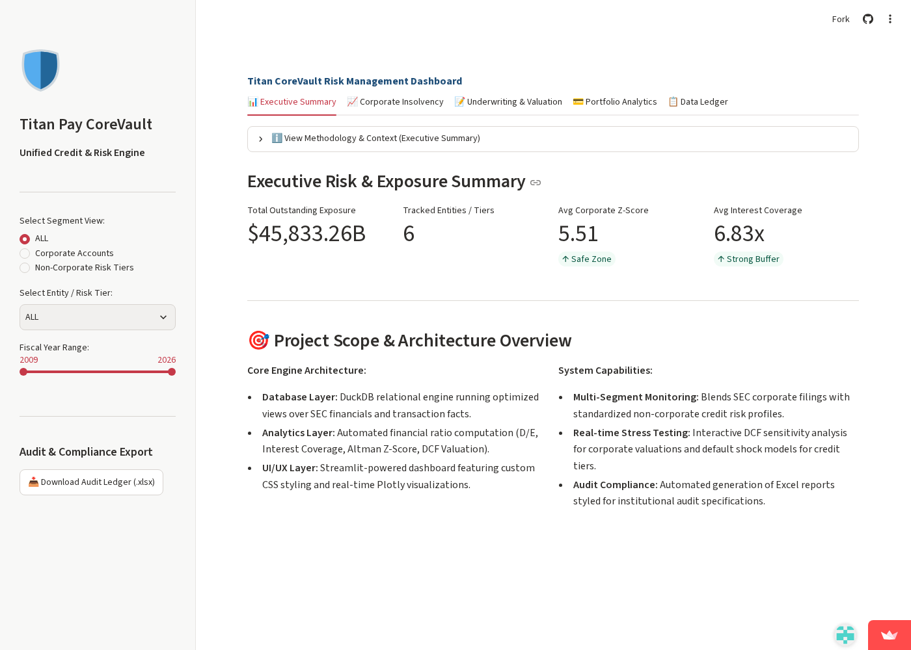
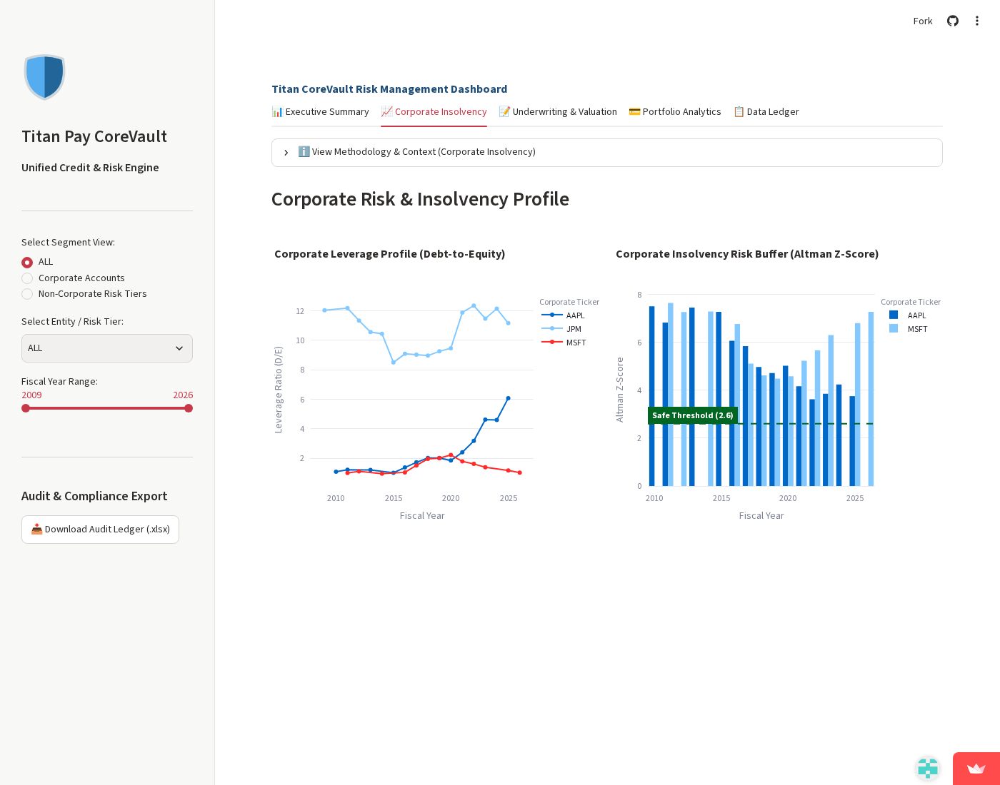
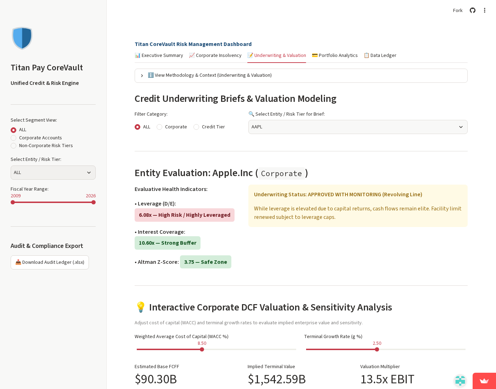

# Titan Pay: CoreVault Enterprise Risk Engine & Reconciliation Dashboard

[](https://titan-pay-corevault.streamlit.app/)

**Live App:** [https://titan-pay-corevault.streamlit.app/](https://titan-pay-corevault.streamlit.app/)

The free Streamlit Community Cloud host sleeps when the app is idle. If you see a sleep screen, click **Yes, get this app back up!** and wait about a minute for it to reload.

**Course:** Washington State University, FIN 429, revamped Aug. 2026.

## Executive Summary

This is a revamped FIN 429 course project. The case study follows a fictional payment processor, Titan Pay, after the acquisition of a regional firm whose reporting still lived in fragmented ledgers and spreadsheets. The goal of the project is a single place to review corporate counterparty risk and retail credit-tier exposure.

**CoreVault** is a Streamlit dashboard on a DuckDB database. It standardizes financial metrics, calculates credit ratios, and supports interactive valuation and stress views, with an Excel export of the credit ledger.

## What the dashboard does

The app, `app.py`, opens five tabs:

1. **Executive Summary:** Portfolio-level metrics such as outstanding exposure, tracked entities, average Altman Z-Score, and average interest coverage.
2. **Corporate Insolvency:** Debt-to-equity trends and Altman Z-Score charts for corporate counterparties (Apple, Microsoft, and JPMorgan, from SEC 10-K filings).
3. **Underwriting & Valuation:** Per-entity credit briefs with color-coded leverage, coverage, and Z-Score indicators. Corporate names include an interactive DCF view (WACC and terminal growth sliders, a sensitivity curve, and a small valuation matrix). Credit tiers include a default-rate shock slider.
4. **Portfolio Analytics:** Monthly leverage, net cash flow, and transaction-density charts for non-corporate credit tiers and synthetic retail accounts.
5. **Data Ledger:** A filterable table of the standardized credit records, plus a sidebar download of a formatted Excel workbook.

Sidebar filters let you switch between corporate accounts and non-corporate risk tiers, pick a single entity, and set a fiscal-year range.

## Screenshots

**Executive Summary**



**Corporate Insolvency**



**Underwriting & Valuation**



## How the project is built

- **Database:** `titan_corevault.duckdb` stores SEC 10-K financials for AAPL, MSFT, and JPM, plus synthetic retail users, accounts, and transactions. The Streamlit app queries this file directly through DuckDB views and SQL.
- **Pipeline notebook:** `financial_risk_pipeline.ipynb` is what builds and refreshes that database. It pulls company facts from the SEC EDGAR API, can pull SOFR rates from the FRED API, and generates the synthetic retail data.
- **Metrics in the app:** Debt-to-equity, an interest-coverage ratio, and a non-bank Altman Z-Score are computed in SQL when the dashboard loads. The DCF and tier stress figures are calculated in the app from the selected entity and slider inputs.
- **Supporting scripts:** `src/data_loader.py` and `src/calculations.py` contain CSV ingestion, DuckDB query, merchant-exposure, and refund-anomaly helpers. The current Streamlit app does not import these modules.
- **Documentation diagrams:** The `Docs/` folder has a context diagram, a data flow diagram, and 1NF through 3NF normalization diagrams.

## Tech Stack

- **Language & querying:** Python, SQL (DuckDB)
- **Dashboard:** Streamlit, Plotly
- **Data manipulation:** Pandas, NumPy
- **Reporting:** openpyxl (Excel ledger export)
- **Data sources used in the notebook:** SEC EDGAR company facts and, for SOFR rates, the FRED API
- **Environment:** Jupyter Notebook, Visual Studio Code

## Project Structure

```text
├── Docs/                              # Context DFD, process DFD, and 1NF-3NF diagrams
├── src/
│   ├── calculations.py                # Merchant exposure and refund-anomaly helpers
│   └── data_loader.py                 # CSV ledger loader and DuckDB query helper
├── app.py                             # Streamlit dashboard
├── financial_risk_pipeline.ipynb      # Builds and refreshes the DuckDB database
├── titan_corevault.duckdb             # Local analytics database used by the app
├── corporate_credit_risk_report.xlsx  # Sample Excel credit report
├── requirements.txt                   # Python package dependencies
└── README.md
```

## Run locally

1. Clone the repository:

```bash
git clone https://github.com/npfeifer-dev/titan-pay-corevault.git
cd titan-pay-corevault
```

2. Create a virtual environment and install dependencies:

```bash
python -m venv venv
source venv/bin/activate  # On Windows use: venv\Scripts\activate
pip install -r requirements.txt
```

3. Start the dashboard:

```bash
streamlit run app.py
```

The app reads `titan_corevault.duckdb` from the repo root. You do not need an API key to run the dashboard.

### Optional: refresh data in the notebook

Open and run `financial_risk_pipeline.ipynb` if you want to rebuild or update the database. To pull SOFR rates from FRED, the notebook calls `os.getenv("FRED_API_KEY")` after `load_dotenv()`. Set that variable in a local `.env` file before running those cells. The notebook also installs a few packages that are not listed in `requirements.txt`, including `fredapi`, `python-dotenv`, and `faker`.
